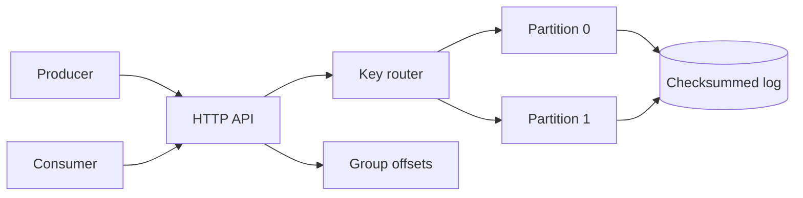

# streamforge

A small partitioned event log for understanding what sits underneath a message broker.

It writes checksummed records to disk, preserves absolute offsets through retention, routes keys consistently, fences stale partition leaders, and keeps consumer-group offsets monotonic. It is intentionally not Kafka-compatible.

## Current behavior

- ordered append-only partitions with an `fsync` before acknowledgement
- corruption and truncation detection during recovery
- stable replay offsets after retention compaction
- deterministic key-to-partition routing
- serialized concurrent writers and non-blocking backpressure
- consumer-group offset isolation with rewind protection
- expiring leader leases with fencing epochs
- HTTP append, replay, and offset APIs
- bounded record and read-batch sizes
- graceful process shutdown and persistent Compose volume



## Run

```sh
cargo test
docker compose up --build
```

Append and replay a record:

```sh
curl -X POST http://localhost:8080/v1/topics/orders/records \
  -H 'content-type: application/json' \
  -d '{"key":"customer-42","payload":"order.created"}'

curl 'http://localhost:8080/v1/topics/orders/partitions/0/records?offset=0&limit=100'
```

Commit a consumer offset:

```sh
curl -X PUT http://localhost:8080/v1/groups/billing/partitions/0/offset \
  -H 'content-type: application/json' \
  -d '{"next_offset":1}'
```

## Boundaries

This is a single-node learning system, not a drop-in replacement for Kafka, NATS, or Redpanda. It does not yet replicate logs across nodes or provide a gRPC interface. Leader leases model fencing semantics but are in memory; a clustered deployment would put that state behind consensus. Those limits are explicit so the implemented durability claims stay testable.
